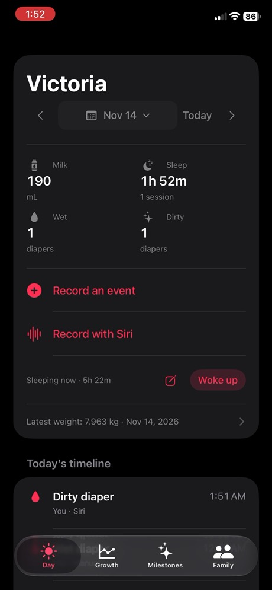

# Victoria Tracker

**Care, sleep, growth, and little firsts. Shared by both parents.**

A native iOS 17+ app built with SwiftUI, App Intents, Supabase and OpenAI structured extraction. Two parents share baby profiles, feedings, diapers, sleep, weights and milestones. The iOS app has no third-party package dependencies.

Source-release versions and the iOS marketing/build version are independent. See the [changelog](CHANGELOG.md) for features and fixes and [release status](docs/RELEASE.md) for validation limits.

It uses a short Siri conversation:

> “Hey Siri, Victoria Tracker.” → “What’s up?” → “Victoria drank 180 mL.”

Siri confirms saving only after the database confirms persistence; questions return read-only answers. English, Cantonese and code-switching descriptions are implemented, with English app screens and an internet connection required. Cantonese Siri recognition depends on the phone’s Siri language; a bounded 50 mL recording passed on the tested phone. Spoken reply language was not separately confirmed. Arbitrary descriptions cannot reliably be captured inside a single App Shortcut trigger; the supported interaction is two turns. [Siri behavior and examples](docs/SIRI.md)

## Conversational care questions

Ask about recorded feeding, diapers, sleep, weight and milestones in English or Cantonese. Shared interpretation distinguishes current recorded state, historical events, counts, latest events, totals and elapsed time. Answers qualify missing or stale records, separate completed sleep from open sessions, and use natural units and contextual dates. Short follow-ups can refer to the exact prior feeding. See [query examples, taxonomy and limitations](docs/CONVERSATIONAL_QUERIES.md).

The current source release also supports memory title/note search and sorting, clearer recorded sleep-state replies, and recent feeding descriptions such as “She had 60 mL just now.” See [changes](CHANGELOG.md) and [release status](docs/RELEASE.md).

## Demo

<a href="https://github.com/user-attachments/assets/3daf4e10-2eb3-47ad-a6f9-5e00d1d11e1d">
  
</a>

[Watch the 45-second demo](https://github.com/user-attachments/assets/3daf4e10-2eb3-47ad-a6f9-5e00d1d11e1d) — Siri recording, daily care totals, WHO growth charts and milestones.

Recorded on a physical iPhone using a showcase account with synthetic data. This demo shows an earlier MVP; the [changelog](CHANGELOG.md) covers the newer voice queries and age guide.

## Built with Codex

I defined the product, directed development, and tested the app on physical iPhones. OpenAI Codex generated the implementation, tests, and documentation through iterative conversations. See the [release notes](docs/RELEASE.md) for validation results and known limitations.

## 1. Get the project and prerequisites

```sh
git clone https://github.com/kurtcms/victoria-tracker-public.git victoria-tracker-public
cd victoria-tracker-public
export DEVELOPER_DIR=/Applications/Xcode.app/Contents/Developer
xcodebuild -version
```

Install full Xcode, open it once and complete its license/component prompts. This release was built and tested with **Xcode 27.2**. You need a signing team in Xcode and an iPhone running iOS 17 or later.

For backend setup/testing, install **Supabase CLI 3**, **Deno 2** and Python 3.9+. Docker is required only for isolated database tests or a full local Supabase stack. With Homebrew already installed:

```sh
brew install supabase/tap/supabase deno
supabase --version
deno --version
python3 --version
```

The backend commands below use CLI 3 syntax, verified with **3.1.0**. Other installation options: [Supabase CLI](https://supabase.com/docs/guides/local-development/cli/getting-started), [Deno](https://docs.deno.com/runtime/getting_started/installation/).

**Using an existing configured backend?** Obtain its HTTPS URL, **public publishable key**, and an account/family invitation from the owner, then skip to step 3. Build 14 requires the additive `202611140001_voice_care.sql` migration and updated `care-command` function; the owner should review/apply that upgrade first. Build 16 additionally needs `202611160001_read_snapshot.sql` and the matching `care-command` update, after the build 15 `202611150001_care_queries.sql` migration. Apply all required migrations to your own project before using these features. Do not rerun setup or change an existing project’s Auth settings. No private key is needed to build the app.

## 2. Set up a fresh Supabase backend

Run these steps only against a project you own or have permission to configure. Hosting and actual OpenAI interpretation can incur costs. The repository includes no cloud project, credentials, accounts or baby records.

### Configure Auth

Create/select a Supabase project with PostgreSQL 15 or later. In its dashboard:

1. Enable email/password sign-in and email confirmation; use a minimum password length of 12.
2. Set **Site URL** and add the exact allowed redirect **`com.victoriatracker.app://auth/confirm`**. Preserve other destinations you intentionally use. This prevents signup links falling back to localhost.
3. Temporarily allow new users to sign up while the two parents create their accounts in step 4. Keep OpenAI unconfigured until signup is closed again in step 5.
4. Expose the `public` schema through the Data API; do not expose `private`.

The default email service has delivery/rate limits; configure SMTP if needed. Never share confirmation links or passwords in Git/issues.

### Apply the database and deploy the functions

From the repository root:

```sh
supabase login
export VT_PROJECT_REF=YOUR_PROJECT_REF

# Fresh-project checks: every row must report ok=true.
supabase db query --remote="$VT_PROJECT_REF" --read-only \
  --file supabase/preflight.sql

# Review exactly what will be applied, then apply once.
supabase db push --remote="$VT_PROJECT_REF" --skip-vault --dry-run
supabase db push --remote="$VT_PROJECT_REF" --skip-vault

supabase db query --remote="$VT_PROJECT_REF" --read-only \
  --file supabase/verify_deployment.sql

supabase functions deploy care-command --remote="$VT_PROJECT_REF" --use-api
supabase functions deploy record-event --remote="$VT_PROJECT_REF" --use-api
```

Replace `YOUR_PROJECT_REF` with the project reference from its dashboard. Interactive hosted commands ask for confirmation. All post-migration checks must pass. **Never run `supabase/tests/*.sql` on a hosted project.** Those are destructive fixtures for disposable local databases.

The source has seven migration files in filename order: the original three, `202611140001_voice_care.sql`, `202611150001_care_queries.sql`, `202611160001_read_snapshot.sql`, then `202611190001_voice_pronouns.sql`. Apply all seven to a fresh project before deploying the functions, then treat them as immutable. Preserve them unchanged after application; future schema changes need a new migration. `care-command` handles current app actions. `record-event` is retained for older pending entries and shared validation code. Both have **`verify_jwt=true`** and independently authenticate the signed-in user; do not deploy with verification disabled.

There is deliberately no OpenAI key yet. Account/family setup and manual recording work without OpenAI; natural-language recording will work after step 5.

## 3. Configure and install on your iPhone

Before downloading WHO data, review [third-party notices](THIRD_PARTY_NOTICES.md) and the linked WHO terms. Numerical reference tables are downloaded locally and excluded from Git.

```sh
python3 scripts/import_who_reference.py
cp ios/Config.local.xcconfig.example ios/Config.local.xcconfig
open ios/VictoriaTracker.xcodeproj
```

Edit the ignored `ios/Config.local.xcconfig` locally:

```xcconfig
SUPABASE_URL = https:/$()/YOUR_PROJECT_REF.supabase.co
SUPABASE_PUBLISHABLE_KEY = sb_publishable_YOUR_PUBLIC_KEY
```

Use the project’s **publishable key** (a legacy `anon` key is also supported). Keep `https:/$()/` exactly: plain `//` begins an xcconfig comment; Xcode expands `$()` to produce the correct HTTPS URL. The URL/key are intentionally public in the installed app. **Never use an OpenAI key, service-role key, `sb_secret_` key or user session token here.** The build and runtime reject server/session keys.

In Xcode:

1. Add your Apple account under **Xcode → Settings → Accounts**.
2. Select the `VictoriaTracker` target → **Signing & Capabilities**. Select your team and enable automatic signing. Choose an available bundle identifier if `com.victoriatracker.app` is unavailable. Select your team for `VictoriaTrackerTests` too if running device tests. You can keep `DEVELOPMENT_TEAM` in the ignored local xcconfig instead.
3. Keep the supplied Auth URL scheme/callback even if you change only the product bundle identifier. A custom callback requires coordinated edits to `Core/EmailConfirmation.swift`, `Resources/Info.plist` and Supabase’s redirect settings.
4. Connect your iPhone by USB, unlock it and approve **Trust** on the Mac/phone. Select it as the run destination. Enable **Settings → Privacy & Security → Developer Mode** and restart if requested.
5. Choose **Product → Run**. Complete any developer trust prompt under **Settings → General → VPN & Device Management**, then open the app.

See [Apple’s device-running guide](https://developer.apple.com/documentation/xcode/running-your-app-on-a-device). Development signing expires; a personal team can require frequent rebuilding/reinstallation. No signing certificates, provisioning profiles or App Store/TestFlight configuration are included.

A “Connect Supabase” screen means configuration is missing/invalid: correct the local xcconfig and rebuild. Editing it does not reconfigure an installed binary. Use a hosted HTTPS backend for a physical phone; the client deliberately does not accept the CLI’s HTTP localhost URL.

## 4. Set up the shared family

For a fresh backend:

1. Parent A taps **Create account**, uses their own email and a password of at least 12 characters, and opens the confirmation email **on the same iPhone**. The PKCE callback returns to the app. If confirmed elsewhere, sign in manually afterward.
2. Parent A creates the family with the baby’s name. Under **Family**, complete the baby’s birth date, WHO reference and birth profile, then save. Percentile curves require these fields and a supported non-premature profile; recorded weights remain available without curves.
3. Parent A generates a family invite under **Family**.
4. Install/configure the app on Parent B’s phone. Parent B creates and confirms a **different** account, chooses **Join your partner**, and enters the invite. Do not create a second family. Invites are single-use and expire after 24 hours.

Each account belongs to one family; this MVP supports two parents per family. Additional babies can be added/renamed/archived under **Family**. One baby keeps a simple dashboard; multiple babies get All babies and individual views.

For an existing backend with signup closed, ask its owner to provision your account or approve a short signup window. Existing accounts can still sign in. A family invitation does not itself create an Auth account.

## 5. Close signup and enable interpretation

After both accounts exist, disable **Allow new users to sign up** in Supabase Auth. **Keep the email provider enabled** and email confirmation required. Closing signup must not disable email/password login.

For CLI configuration, global `[auth] enable_signup=false` closes registration. In CLI 3, `[auth.email] enable_signup=false` disables the email provider and also breaks login. Do not push the entire local `supabase/config.toml` to a hosted project; it contains development defaults. Scope config changes and review `config diff` first. [Security details](docs/SECURITY_AUDIT.md)

Prepare the ignored server-secret file in a local editor:

```sh
cp supabase/.env.example supabase/.env.local
```

Set `OPENAI_API_KEY` and optionally `OPENAI_MODEL` (default **`gpt-4.1-mini`**). If legacy Supabase API keys are disabled, also set `VT_SUPABASE_PUBLISHABLE_KEY` to your public publishable key. Keep keys out of command arguments, Git and screenshots. Then upload the secrets:

```sh
supabase secrets set --env-file supabase/.env.local --remote="$VT_PROJECT_REF"
```

Supabase supplies `SUPABASE_URL` and normally `SUPABASE_ANON_KEY` to functions. The custom `VT_` variable avoids the reserved environment prefix. The runtime uses the public key and caller JWT; it never needs a service-role key. Manual actions and confirmations do not call OpenAI. Recognized English/Cantonese care questions use deterministic interpretation and formatting; other supported natural language uses finite model extraction. Automated checks and historical physical results have different coverage; see [release status](docs/RELEASE.md).

## 6. Verify Siri recording

Sign in and open the dashboard once. Enable Siri and any Victoria Tracker permission iOS requests. No separate SiriKit extension, App Group or Siri entitlement is required.

1. Say **“Hey Siri, Victoria Tracker.”** If that opens the app, use **“Hey Siri, Talk to Victoria Tracker.”**
2. After “What’s up?”, say **“Victoria drank 180 mL.”** Use your baby’s actual profile name.
3. Wait for confirmation, then check Day and Supabase’s `public.events` table: exactly one feeding, 180 mL, the correct child and recording parent.
4. On the other parent’s phone, open the same child and pull to refresh. The same entry should appear once.

Siri may display a confirmation silently according to its response settings. Enable **Always Show Request** and **Always Show Siri Captions** under Siri Responses to show speech; choose spoken responses if desired. With one baby, “She just drank 160ml” and “He pooped/peed just now” target that baby. Set **Family → Edit baby → Voice pronoun** for multiple babies: a simple recording can use she/he only when every active profile has a configured pronoun and exactly one matches. Ambiguous, unset or complex descriptions ask for a name. Questions and corrections still need a profile name with multiple babies. WHO charts and dashboard selection do not choose a voice target.

After the prompt you can describe one to five events for the same baby, ask about saved records or daily totals, or request a correction/deletion of the latest qualifying record. Every edit or deletion needs a separate confirmation. `mil` is accepted as mL for recording; ounce recording is unsupported. Read responses can display approximate US units when explicitly requested. In the Milestones **Age guide**, tap the title/check button to record today, or a checked item to review removal. **Choose an earlier date** remains available; source links sit in checkpoint descriptions. The [source notes](docs/MILESTONE_SOURCES.md) explain the checkpoint ages.

Further examples and optional regression steps: [Siri](docs/SIRI.md), [acceptance checks](docs/ACCEPTANCE.md). A fresh Siri invocation is a separate recording. If a response is lost, use the original **Retry / check recording** entry instead of speaking the event again.

## Development

```sh
# Type checks and mocked backend tests: no cloud credentials or paid calls.
deno task --config supabase/functions/care-command/deno.json check
deno task --config supabase/functions/care-command/deno.json test
deno task --config supabase/functions/record-event/deno.json check
deno task --config supabase/functions/record-event/deno.json test

python3 -m unittest discover -s tests -p 'test_*.py'
python3 scripts/security_checks.py source

# Disposable, network-isolated PostgreSQL; Docker must be running.
python3 scripts/test_database.py

# Core tests; UI, Keychain/Auth and Siri forwarding tests use Xcode below.
swift test --scratch-path /private/tmp/victoria-core-tests

# Choose an ID from xcrun simctl list devices available.
xcodebuild -project ios/VictoriaTracker.xcodeproj -scheme VictoriaTracker \
  -destination 'platform=iOS Simulator,id=YOUR_SIMULATOR_ID' \
  -derivedDataPath /private/tmp/victoria-ios-tests CODE_SIGNING_ALLOWED=NO test
```

Keep `DEVELOPER_DIR` exported as in step 1. Tests use mocks/synthetic fixtures, not live baby data. [Testing and built-artifact checks](docs/TESTING.md)

The checked-in Xcode project is ready to open. After adding/removing sources/resources, regenerate it with `python3 scripts/generate_project.py`; existing bundle IDs, signing choices and versions are preserved. Bundled WHO tables and the app icon are already included; optional regeneration scripts are under `scripts/`.

```text
ios/         SwiftUI app, App Intents, resources and Xcode project
supabase/    Seven additive migrations, two Edge Functions, local tests
tests/       Swift and Python tests
scripts/     Project/assets generation, security and database checks
docs/        Architecture, API, security, Siri, testing and release status
```

Refreshes happen on activation, successful writes, pull-to-refresh and every ten seconds while active. Each phone uses its current timezone; travelling parents can see different day totals for shared UTC records. Recording is online, with recovery of uncertain requests rather than a general offline queue. Normal entry supports the preceding 366 days. WHO curves cover birth through five years; premature percentile interpretation is outside this MVP.

See [setup](docs/SETUP.md), [architecture](docs/ARCHITECTURE.md), [API](docs/CARE_API.md), [security](docs/SECURITY_AUDIT.md), [conversational query limits](docs/CONVERSATIONAL_QUERIES.md) and [release validation](docs/RELEASE.md). Historical physical results remain bounded by their recorded scope; new real-provider and speech-recognition accuracy is not claimed.

Original code and artwork: [MIT](LICENSE). WHO reference tables are downloaded locally and are excluded from this repository; their use is governed by [third-party notices](THIRD_PARTY_NOTICES.md).
