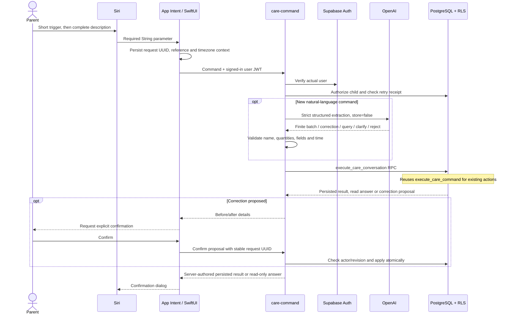

# Architecture

The app target contains SwiftUI, App Intents and a dependency-free URLSession client. `AppModel` coordinates selection/refreshes; the `Backend` actor coordinates authentication, pending commands and writes. A Swift package exposes pure core calculations for fast tests.

## Data and access

- `families`, `family_members`, `children`: one family per account, two parents, multiple distinctly named active babies. Renaming preserves UUIDs/records; archiving retains history.
- `events`: shared metadata plus constrained feeding/mL, diaper/wet-dirty-mixed or weight/kg payload. Invoker-security views expose each category. `measurement_date` is authoritative for date-only weights; `occurred_at` supports day queries.
- `sleep_sessions`: start/wake instants, one open session per child, no overlapping active intervals. Daily totals intersect sessions with the phone-local day. Either parent can wake the same session after process restarts.
- `milestones`: day/month precision, title, optional note, first-occurrence flag and optional stable `guide_id`. One active observation per child/guide ID is enforced independently of free-text memories; existing memories are never inferred or relabelled. Exact dates show completed age; month-only dates show an approximate range clipped to birth/today.
- `care_proposals`, `care_revisions`, `care_receipts`: actor-bound confirmation, before/after history and idempotent command results. Feeding corrections retain the original bottle basis and update the original feeding only after confirmation. Zero consumed total voids the entry.

UUIDs identify records; UTC `timestamptz` stores instants. RLS grants family reads and actor-private proposal/receipt reads. Direct client mutations are revoked. Security-definer RPCs derive the actor from `auth.uid()`, check membership and use empty search paths. [Security](SECURITY_AUDIT.md)

## Interpretation

There is one discoverable prompted String intent, no default event, and compiled English and zh-HK phrase resources. Four old fixed-preset identifiers remain hidden tombstones that fail before networking; cached actions must never submit obsolete numerical presets.

With multiple babies, speech must literally identify exactly one authorized profile; UI selection cannot replace the name. The model returns a strict root interpretation wrapper with operation-specific batch, correction or query alternatives. Only neutral defaults are normalized; meaningful conflicting fields still clarify. The authenticated `execute_care_conversation` RPC accepts `action`, `batch`, `correct` and `query`, delegating existing operations through private `execute_care_conversation_v14`, which reuses `execute_care_command` for existing actions. Deterministic code validates quantities against text, supported explicit dates against interpreted dates, and milestone wording against submitted words. It cannot repair Siri transcription or prove semantic correctness. Supported questions become read-only database queries. Negations, hypotheticals, unsupported questions and ambiguity reject or clarify rather than save. One to five new events for one baby validate together and save atomically; corrections and questions cannot be mixed into that batch. Voice corrections select only the latest qualifying record, reject ties or mismatched expected amounts, and use the existing actor/revision-bound confirmation flow.

Manual actions and confirmations do not use OpenAI. Build 15 also routes common whole-request English care questions through an authenticated closed grammar without a model call. Other natural language uses the configurable model (default `gpt-4.1-mini`) with `store=false`. The model receives no database credentials, arbitrary SQL tools or authority to choose a recording parent. `record-event` remains for legacy pending entries and shared validation imported by `care-command`.

## Time, retries and synchronization

Before sending, the client captures UUID, UTC reference, IANA zone and offset transitions covering the preceding 366 days. Captured offsets resolve local wall times even when backend timezone rules differ from the phone. Gaps/overlaps ask for clarification. Future events reject against the original reference; reference-clock tolerance does not authorize future care events. Date-only weights need no clock time.

Tokens/unresolved commands use device-only Keychain storage accessible after first unlock. Uncertain retries retain the original account, UUID, body and time context. Travel/sign-out cannot reattribute them. Per-request/per-child locks, hashes, uniqueness and revisions prevent duplicate retries or competing corrections. Separate Siri invocations intentionally have different UUIDs. Batches retain one outer UUID and deterministic per-position inner IDs; a later failure rolls back every earlier write and inner receipt. Query answers use `answered`, create no care rows/proposals/receipts, and are never persistence confirmations. Original pending request bodies/hashes remain compatible. Concurrent extraction can cost more than one model call even when only one write persists.

Refreshes run on activation, pull-to-refresh, successful commands, significant time/zone changes and every ten seconds while active. No background polling/Realtime subscription is used. Reads are paginated. Selection generations discard stale responses; failed refreshes do not fabricate zero totals. Mixed diapers contribute once to each wet/dirty count.

Calendars and displayed times follow the phone; travelling parents can see different day totals. Growth uses bundled official WHO daily LMS tables (0–1856 days), calendar age and measurement date. Missing profile prerequisites disable reference curves without hiding measurements; premature percentile interpretation is unsupported. [WHO sources/hashes](../ios/VictoriaTracker/Resources/Growth/SOURCE.json)

English, Cantonese and code-switching text use the same finite schema and deterministic quantity/date checks. Static server replies format database facts in English or Cantonese; the UI remains English. Captured phone offset transitions also define query-day boundaries; mixed diapers count in both wet and dirty totals and sleep is clipped to that day/reference. Missing latest records produce explicit no-record answers. A bounded live Cantonese 50 mL case persisted successfully with server language yue; spoken reply language was not separately confirmed. Siri supplies text and there is no separate transcription service.

The static 88-item [milestone guide](MILESTONE_SOURCES.md) spans birth through five years, distinguishing CDC by-age checkpoints from Rourke visit surveillance. It uses chronological age and links to official CDC/AAP/RBR/CPS sources. Guide observations store explicit identity, not title similarity; rapid taps, uncertain retries and two-parent uniqueness use the same stable-command recovery path.
